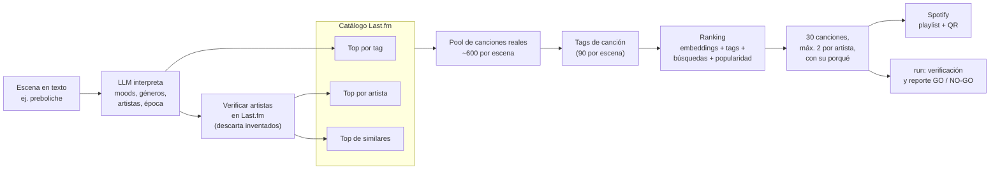

# onda. — idea y pipeline

Última actualización: 2026-11-23

## Idea

**onda.** arma una playlist a partir de una escena descrita en lenguaje natural, por ejemplo *"Preboliche con amigos: reguetón divertido y conocido para cantar todos"*. Después la playlist se exporta a Spotify.

El principio de diseño es este: **el LLM interpreta la escena, el catálogo pone las canciones y Spotify solo exporta.**

- **Interpretar.** Un LLM chico y local traduce la escena a moods, géneros, artistas de referencia y época. No nombra canciones.
- **Buscar.** Las canciones salen de Last.fm: las más escuchadas para cada género pedido, para cada artista y para artistas similares. Como vienen del catálogo, son reales.
- **Rankear y explicar.** El género pedido es un requisito y el mood una preferencia. Cada canción se puntúa según sus tags y los de su artista (embeddings + géneros + moods + época + popularidad), y la playlist dice por qué eligió cada una.
- **Exportar.** Spotify solo busca la canción y crea la playlist. La cláusula 14 de su Developer Policy prohíbe usar su contenido en modelos de IA, así que ningún dato de Spotify entra al ranking ni al LLM.

**Por qué este enfoque.** El plan original era que el LLM propusiera las canciones directamente. Con un modelo grande (Claude Opus 5.5) funciona, pero con uno chico local (`gemma4:12b`) 1 de cada 3 canciones no existe. Ver [Evaluación](#evaluación).

## Pipeline

1. **Interpretación** (`build`). El LLM devuelve JSON con 3–6 moods, 2–5 géneros, 5–8 artistas y la época. Se le apaga el razonamiento (`reasoning_effort=none`), porque si no gasta todos los tokens pensando.
2. **Chequeos contra la escena y el catálogo.** Los artistas se buscan en Last.fm y se descartan los que no existen (en la evaluación, uno inventado en 4 de las 6 escenas). La época solo se usa si la escena la nombra: el modelo agregaba "1980s" a un asado o "2020s" a una previa.
3. **Pool.** Los **géneros** y la época traen canciones: las 50 más escuchadas por tag ("80s", no "1980s", que es el tag que se usa). Se suman las 10 de cada artista y las 5 de 3 similares por artista. Los moods no traen canciones: un top de "party" trae hits globales de cualquier género. Se sacan versiones en vivo, remixes y karaoke.
4. **Tags.** A 120 canciones del pool se les piden oyentes, tags de canción y **tags del artista** (en música local, las canciones casi no tienen tags pero el artista sí). Primero van las que aparecieron en varias búsquedas; después, por turnos, la mejor de cada búsqueda.
5. **Ranking.** Promedio ponderado de: similitud de embeddings escena vs. tags (0,30), tiene un género pedido (0,20), moods pedidos (0,15), **afinidad del artista con los artistas de referencia** (0,15), en cuántas búsquedas apareció (0,15), época (0,10) y popularidad (0,10). **Sin ningún género pedido, el puntaje se multiplica por 0,25**; sin la época pedida, por 0,30; con afinidad muy baja, por 0,5. Pesos en `config.toml` (`[build]`).
    - *Afinidad:* los tags de los artistas de referencia arman el "perfil" de la escena ("tipo Carlos Vives" → latin, colombia, vallenato) y se mide qué tanto se parece el artista de cada canción. Hace falta porque los géneros que pide el modelo a veces son amplios: "tropical" en Last.fm suele ser *tropical house*, y por ese tag entraban TWICE o Katy Perry en una escena de vallenato.
6. **Selección.** Las 30 mejores, sin repetidas, con un máximo de 2 por artista y lugares reservados para cada género pedido (si no, en "cumbia y reggaetón" el reggaetón ocupa todo). Cada canción guarda su puntaje desglosado y su explicación ("género: cumbia; artista de referencia").
7. **Verificación y export.** `run` mide existencia, reconocibilidad, tags y Spotify; `relevance` mide si son del género o la época pedidos; `export` crea la playlist.

## Datos y modelos

| Componente | Rol | Licencia / acceso |
| --- | --- | --- |
| `gemma4:12b` (Ollama, local) | Interpreta la escena | Local, gratis |
| `embeddinggemma` (Ollama, local) | Embeddings para el ranking | Local, gratis |
| Last.fm | Catálogo (top tracks por tag y artista), oyentes y tags | API key; para uso académico hay que escribir a partners@last.fm |
| MusicBrainz | Verificación: existencia y año | Abierta, 1 request/s |
| ListenBrainz | Verificación: popularidad y tags | CC0 |
| Spotify | Solo encontrar la canción y exportar | OAuth PKCE; en modo desarrollo, máx. 5 usuarios |

**Prompts de prueba (6):** preboliche, lluvia, estudio, entrenamiento y nostalgia, más uno de estrés, `previa_local` (cumbia, cuarteto, RKT).

**Mood.** Un tag cuenta como mood solo si *es* una entrada del léxico (party, chill, nostalg*, perreo…), no si la contiene.

**Matching.** Artista y título tienen que tener una similitud ≥ 0.85 después de normalizar (tildes, "feat.", "(Remastered)").

## Evaluación

Comparamos cinco sistemas con los mismos 6 prompts y 30 canciones por prompt: el LLM grande generando, el chico generando, y dos versiones de onda. Detalle en [`results/comparacion.md`](../results/comparacion.md) y [`results/relevancia.md`](../results/relevancia.md).

**Cómo se ajustó sin hacer trampa.** Lo que espera cada escena (géneros o época) se escribió a mano en `config.toml` antes de tocar el ranking. Los ajustes de onda. v2 se hicieron mirando solo 6 **escenas de desarrollo** distintas (`[[dev_prompts]]`: asado, ruta de noche, cena, limpieza, fiesta de 15, lectura). Las 6 de evaluación se corrieron una sola vez al final.

### ¿Existen las canciones?

| Métrica | Umbral | Opus genera | gemma4 genera | onda. v1 | onda. v2 | **onda. v3** |
| --- | --- | --- | --- | --- | --- | --- |
| Existe en MusicBrainz | ≥ 80% | 97% | 57% | 94% | 98% | **98%** |
| No encontrada en ninguna fuente | — | 1% | 33% | 0% | 0% | **0%** |
| Reconocible | ≥ 60% | 92% | 57% | 99% | 91% | **90%** |
| ≥ 3 tags a nivel canción | ≥ 50% | 70% | 53% | 91% | 78% | **78%** |
| Se encuentra en Spotify | ≥ 70% | sin medir | 62% | 99% | sin medir* | sin medir* |
| Artistas distintos / canciones | — | 82% | 86% | 63% | 66% | 66% |

\* Spotify bloqueó la app por ~21 h el 23/11 por exceso de búsquedas en modo desarrollo. Se mide cuando se libere.

### ¿Encajan con la escena? (relevancia)

| Escena | Qué se mide | Opus genera | gemma4 genera | onda. v1 | onda. v2 | **onda. v3** |
| --- | --- | --- | --- | --- | --- | --- |
| preboliche | género reggaetón / latino | 100% | 44% | 63% | 87% | **87%** |
| lluvia | género folk, jazz, ambient… | 87% | 47% | 87% | 100% | **97%** |
| estudio | género ambient, clásica, lo-fi… | 97% | 57% | 83% | 100% | **100%** |
| entrenamiento | género metal, hip hop, electrónica… | 100% | 60% | 93% | 100% | **100%** |
| nostalgia | lanzada 2000–2009 | 93% | 88% | 66% | 77% | **83%** |
| previa_local | género cumbia, cuarteto, RKT | 67% | 0% | 7% | 50% | **50%** |
| **Promedio** | | **91%** | **49%** | **66%** | **86%** | **86%** |

v2 = género como requisito; v3 = v2 + afinidad con los artistas de referencia. En desarrollo, v3 subió de 88% a 90% (la escena "tipo Carlos Vives", de 90% a 97%). En evaluación el promedio no cambia, pero las listas mejoran donde la medida por género no llega: en lluvia salen la música de Minecraft (C418) y Mac DeMarco y entra Miles Davis; en nostalgia sale "Creep" (1992).

**Lo que muestra:**

- **El mismo modelo chico pasa de 49% a 86% de relevancia y de 33% a 0% de canciones inventadas** cuando interpreta la escena en vez de nombrar canciones. Queda a 5 puntos del modelo grande, corriendo local y gratis.
- En lluvia, estudio y entrenamiento onda. v2 iguala o supera a Opus.
- **La medida subestima la música local.** En `previa_local`, 11 de las 15 canciones que cuentan como fallo son cumbia o cuarteto (Los Palmeras, La Delio Valdez, La Joaqui, La Barra, Banda XXI) que no tienen ningún tag en las fuentes de verificación. Los fallos reales son 4 (Trueno ×2, Duki, Six Sex: trap y neoperreo). Revisado a mano, serían ~87%. No se corrigió la medida después de ver el resultado; le pasa lo mismo a Opus.
- **La medida de época también tiene ruido:** MusicBrainz a veces devuelve el año de una reedición ("Blue Monday" figura de 1993, es de 1983). Es una cota inferior para todos.
- **Nada de esto reemplaza la evaluación humana**: los tags dicen el género, no si la canción encaja con un "preboliche".

## Estado actual y próximos pasos

onda. v3 funciona con el modelo chico: 98% de canciones que existen, 0% inventadas y 86% de relevancia medida (Opus: 91%). Acepta escenas libres ("volviendo del trabajo, algo cantable tipo Carlos Vives") y arma playlists razonables.

**Hecho:** CLI con `check`, `generate`, `build` (también con escena libre: `--scene`), `run`, `relevance`, `export` y `compare`; 67 tests con HTTP falso; evaluación de cuatro sistemas con escenas de desarrollo separadas; export real a Spotify; modo equipo con QR.

### 1. Evaluación humana (lo más importante ahora)

- [ ] Que personas puntúen del 1 al 5 qué tanto encaja cada playlist con su escena, sin saber qué sistema la armó. Comparar Opus genera / onda. v2.
- [ ] Revisar a mano las canciones de `previa_local` que la medida automática no puede juzgar.

### 2. Mejoras conocidas del ranking (ajustar solo con `--dev`)

- [ ] El modelo propone artistas que no encajan aunque existan (Trueno y Duki son trap; Banda MS es banda mexicana). Filtrar artistas de referencia por género.
- [x] Géneros genéricos ("tropical", "pop") dejaban pasar pop global: resuelto con la afinidad del artista (v3).
- [ ] El tono: en "algo divertido" se cuelan temas tristes del género correcto ("Muere una Flor"). El mood pesa poco frente al género.
- [ ] Velocidad: una escena nueva tarda ~2 min (≈300 consultas a Last.fm); repetida, segundos. Para la demo en vivo hay que bajarlo o precargar escenas.
- [ ] Más variedad de artistas: 66% contra 82% con Opus.
- [ ] Año de lanzamiento confiable: consultar la obra en MusicBrainz, no la grabación.

### 3. Pendientes

- [x] Probar el modelo chico (`gemma4:12b`): NO-GO como generador, GO como intérprete.
- [ ] Medir Spotify en onda. v2 cuando se levante el bloqueo (~24/11, 19 h) con `run` sobre `data/candidates/onda-gemma4-12b.json`.
- [ ] **Urgente:** mail a partners@last.fm por uso académico. Last.fm es el catálogo.

### 4. Riesgos

- **Dependencia de Last.fm:** es el catálogo y la fuente de tags. Si no dan permiso académico, hay que buscar otra fuente (por ejemplo, ListenBrainz).
- **Música local:** los tags de cumbia, cuarteto y RKT son escasos en Last.fm.
- **Menos variedad de artistas:** 63% de artistas distintos contra 82% con Opus. Se podría bajar el máximo por artista.
- **Spotify en modo desarrollo:** máximo 5 usuarios y límites de búsqueda bajos. El 23/11 bloqueó la app ~21 h por exceso de búsquedas, y eso también frena `export`. Antes de la demo: no correr `run` con Spotify, y exportar las playlists con tiempo.

### Preguntas abiertas

- ¿Cuál es la fecha de entrega y la del AI Fest?
- ¿Quiénes participan de la evaluación humana y cuántas escenas evaluamos?
- ¿Los umbrales de `config.toml` quedan fijos?
