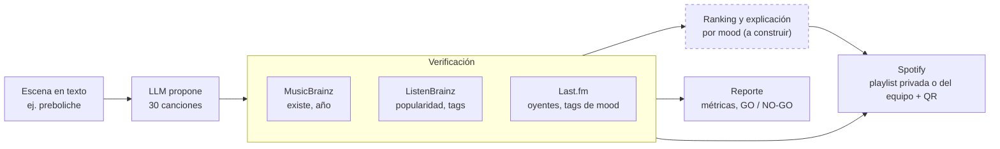

# onda. — idea y pipeline

Última actualización: 2026-11-23

## Idea

**onda.** arma una playlist a partir de una escena descrita en lenguaje natural, por ejemplo *"Preboliche con amigos: reguetón divertido y conocido para cantar todos"*. Después la playlist se exporta a Spotify.

El principio de diseño es este: **el LLM genera, las fuentes abiertas verifican y fundamentan, y Spotify solo exporta.**

- **Generar.** Un LLM propone canciones (artista, título) para la escena.
- **Verificar.** MusicBrainz, ListenBrainz y Last.fm confirman que la canción existe, que es reconocible y qué tags de mood o escena tiene.
- **Exportar.** Spotify solo busca la canción y crea la playlist. La cláusula 14 de su Developer Policy prohíbe usar su contenido en modelos de IA, así que ningún dato de Spotify entra al ranking ni al LLM.

Hoy el repo es una **prueba de factibilidad**: mide con números si los datos alcanzan para construir el producto antes de invertir en él.

## Pipeline

1. **Escena.** El usuario describe la situación en texto libre.
2. **Generación** (`generate`). El LLM devuelve 30 pares (artista, título) en JSON. Ignora los bloques `<think>` y reintenta si la respuesta no se puede leer.
3. **Verificación** (`run`). Cada candidato se busca en MusicBrainz. Se elige la grabación más escuchada en ListenBrainz y se suman los oyentes y tags de Last.fm. Todo queda en una caché SQLite.
4. **Reporte.** Calcula métricas por prompt, las compara con los umbrales de `config.toml` y escribe el veredicto GO / NO-GO en `report.md`.
5. **Ranking y explicación** (a construir). Ordena y filtra las canciones según qué tan bien encajan con la escena, usando los tags verificados.
6. **Export** (`export`). Busca cada canción en Spotify, prefiere la versión de estudio y crea la playlist. Para la demo: `--account equipo --public --qr`.

## Datos y modelos

Cada fuente cumple un solo rol. Todo lo opinable (prompts, umbrales, léxico de mood) está en `config.toml`.

| Fuente | Rol | Licencia / acceso |
| --- | --- | --- |
| LLM (hoy Claude Opus 5.5; después, modelo local con Ollama) | Propone 30 canciones por prompt | API compatible con OpenAI |
| MusicBrainz | Existencia, año, todas las grabaciones | Abierta, 1 request/s |
| ListenBrainz | Popularidad (elige la grabación más escuchada) y tags | CC0 |
| Last.fm | Oyentes y tags de folksonomía (fuente principal de mood) | API key; para uso académico hay que escribir a partners@last.fm |
| Spotify | Solo encontrar la canción y exportar | OAuth PKCE; en modo desarrollo, máx. 5 usuarios |

**Prompts de prueba (6):** preboliche, lluvia, estudio, entrenamiento y nostalgia, más uno de estrés, `previa_local` (cumbia, cuarteto, RKT).

**Mood.** Un tag cuenta como mood solo si *es* una entrada del léxico (party, chill, nostalg*, perreo…), no si la contiene. Contando subcadenas, la cobertura daba 39%; con el tag entero da 22%.

**Matching.** Artista y título tienen que tener una similitud ≥ 0.85 después de normalizar (tildes, "feat.", "(Remastered)").

## Evaluación

Con Claude Opus 5.5 (180 candidatos, corrida del 21/11), los tres criterios que se pudieron medir pasan el umbral. Spotify no se midió en `run` porque faltaban credenciales. Es una cota optimista, porque se usó un modelo grande.

| Criterio | Umbral | Resultado | Prompt débil |
| --- | --- | --- | --- |
| Existe en MusicBrainz (no alucina) | ≥ 80% | 97% | previa_local (87%) |
| Reconocible (≥ 50k oyentes en Last.fm o ≥ 100 usuarios en ListenBrainz) | ≥ 60% | 92% | previa_local (63%) |
| ≥ 3 tags útiles a nivel canción | ≥ 50% | 70% | previa_local (3%) |
| Se encuentra en Spotify | ≥ 70% | sin medir en `run`; en el `export` de preboliche se encontraron 30/30 | — |

Señales sin umbral que importan:

- **Mood a nivel canción: 22%.** Es el punto más flojo: la mayoría de los tags son de género, no de escena.
- **Canciones de 2024 en adelante: 2%** (año mediano: 2006). El LLM tiende a proponer clásicos.
- **Música local** (cumbia, cuarteto, RKT): casi no tiene tags y tiene menos oyentes (mediana: 12.551).

`compare` muestra dos o más corridas lado a lado. Es la herramienta para comparar el modelo grande con el modelo chico.

Las corridas completas están en [`results/`](../results/).

## Estado actual y próximos pasos

La factibilidad de los datos está probada con un modelo grande. Falta probarla con el modelo chico y construir la parte de NLP propia: rankear las canciones y explicarlas por mood.

**Hecho:** CLI con `check`, `generate`, `run`, `export` y `compare`; tests con HTTP falso; export real a Spotify (preboliche, 30/30 encontradas); modo equipo con QR para el AI Fest.

### 1. Cerrar la factibilidad

- [ ] Generar candidatos con el modelo chico (Ollama `gemma4:12b` o `qwen3.5:4b`), correr `run` y compararlo con Opus usando `compare`. Este es el número que decide si seguimos.
- [ ] Cargar las credenciales de Spotify en `.env` y volver a correr `run` para medir el criterio de Spotify en los 6 prompts.
- [ ] Mandar el mail a partners@last.fm para pedir permiso de uso académico.
- [ ] Revisar a mano las 5 canciones no encontradas (¿son alucinaciones o falsos negativos del matching?).

### 2. El aporte de NLP: rankear y explicar

- [ ] Ranking por escena: comparar el prompt con los tags de la canción y del artista (embeddings multilingües o un clasificador zero-shot) para reordenar y filtrar lo que propone el LLM.
- [ ] Ampliar la señal de mood más allá del 22%: mapear tags de género a mood, o pedirle al LLM que asigne el mood y verificarlo contra los tags.
- [ ] Generar una explicación por canción basada en los tags verificados ("está porque tiene los tags party y perreo").

### 3. Evaluación del producto

- [ ] Evaluación humana: que personas puntúen del 1 al 5 qué tanto encaja cada playlist con su escena.
- [ ] Comparar tres sistemas: solo el LLM, LLM + verificación, y LLM + verificación + ranking.

### 4. Riesgos

- **Música local** (cumbia, cuarteto, RKT): solo el 3% tiene tags a nivel canción. Opciones: usar los tags del artista como respaldo, o aceptar el límite y documentarlo.
- **Pocas canciones recientes:** solo el 2% son de 2024 en adelante.
- **Spotify en modo desarrollo:** máximo 5 usuarios. Para la demo usamos la cuenta del equipo + QR.

### Preguntas abiertas

- ¿Cuál es la fecha de entrega y la del AI Fest?
- ¿Qué modelo chico entra en las compus del equipo?
- ¿Los umbrales de `config.toml` quedan fijos?
