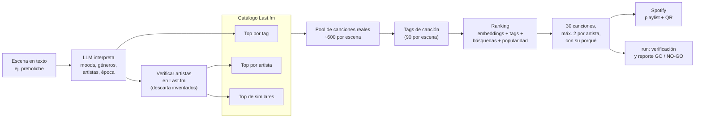

# onda. — idea y pipeline

Última actualización: 2026-11-23

## Idea

**onda.** arma una playlist a partir de una escena descrita en lenguaje natural, por ejemplo *"Preboliche con amigos: reguetón divertido y conocido para cantar todos"*. Después la playlist se exporta a Spotify.

El principio de diseño es este: **el LLM interpreta la escena, el catálogo pone las canciones y Spotify solo exporta.**

- **Interpretar.** Un LLM chico y local traduce la escena a moods, géneros, artistas de referencia y época. No nombra canciones.
- **Buscar.** Las canciones salen de Last.fm: las más escuchadas para cada tag, para cada artista y para artistas similares. Como vienen del catálogo, son reales.
- **Rankear y explicar.** Cada canción se puntúa según qué tan bien sus tags encajan con la escena (embeddings + coincidencia de tags + popularidad), y la playlist dice por qué eligió cada una.
- **Exportar.** Spotify solo busca la canción y crea la playlist. La cláusula 14 de su Developer Policy prohíbe usar su contenido en modelos de IA, así que ningún dato de Spotify entra al ranking ni al LLM.

**Por qué este enfoque.** El plan original era que el LLM propusiera las canciones directamente. Con un modelo grande (Claude Opus 5.5) funciona, pero con uno chico local (`gemma4:12b`) 1 de cada 3 canciones no existe. Ver [Evaluación](#evaluación).

## Pipeline

1. **Interpretación** (`build`). El LLM devuelve JSON con 3–6 moods, 2–5 géneros, 5–8 artistas y la época. Se le apaga el razonamiento (`reasoning_effort=none`), porque si no gasta todos los tokens pensando.
2. **Verificación de artistas.** Cada artista se busca en Last.fm y se descartan los que no existen. En la corrida del 23/11 descartó uno inventado en 4 de las 6 escenas (por ejemplo "Alice Phoebe ==" y "Marconiutas").
3. **Pool.** Junta las 50 más escuchadas por tag, las 10 de cada artista y las 5 de 3 artistas similares por artista. Saca versiones en vivo, remixes y karaoke.
4. **Tags de canción.** A 90 canciones del pool se les piden oyentes y tags. Primero van las que aparecieron en varias búsquedas; después, por turnos, la mejor de cada búsqueda, para que ningún tag tape a los artistas.
5. **Ranking.** Puntaje = 0,45 × similitud de embeddings (escena vs. tags de la canción, `embeddinggemma`) + 0,30 × tags pedidos que tiene + 0,15 × en cuántas búsquedas apareció + 0,10 × popularidad. Los pesos están en `config.toml` (`[build]`).
6. **Selección.** Las 30 mejores, con un máximo de 2 por artista. Cada canción guarda su puntaje desglosado y su explicación ("tags: party, dance; artista de referencia").
7. **Verificación y export.** `run` mide existencia, reconocibilidad, tags y Spotify; `export` crea la playlist.

## Datos y modelos

| Componente | Rol | Licencia / acceso |
| --- | --- | --- |
| `gemma4:12b` (Ollama, local) | Interpreta la escena | Local, gratis |
| `embeddinggemma` (Ollama, local) | Embeddings para el ranking | Local, gratis |
| Last.fm | Catálogo (top tracks por tag y artista), oyentes y tags | API key; para uso académico hay que escribir a partners@last.fm |
| MusicBrainz | Verificación: existencia y año | Abierta, 1 request/s |
| ListenBrainz | Verificación: popularidad y tags | CC0 |
| Spotify | Solo encontrar la canción y exportar | OAuth PKCE; en modo desarrollo, máx. 5 usuarios |

**Prompts de prueba (6):** preboliche, lluvia, estudio, entrenamiento y nostalgia, más uno de estrés, `previa_local` (cumbia, cuarteto, RKT).

**Mood.** Un tag cuenta como mood solo si *es* una entrada del léxico (party, chill, nostalg*, perreo…), no si la contiene.

**Matching.** Artista y título tienen que tener una similitud ≥ 0.85 después de normalizar (tildes, "feat.", "(Remastered)").

## Evaluación

Comparamos tres sistemas con los mismos 6 prompts y 30 canciones por prompt. Los detalles están en [`results/comparacion.md`](../results/comparacion.md).

| Métrica | Umbral | Opus genera | gemma4 genera | **onda.** (gemma4 interpreta) |
| --- | --- | --- | --- | --- |
| Existe en MusicBrainz | ≥ 80% | 97% | 57% | **94%** |
| No encontrada en ninguna fuente | — | 1% | 33% | **0%** |
| Se encuentra en Spotify | ≥ 70% | sin medir | 62% | **99%** |
| Reconocible | ≥ 60% | 92% | 57% | **99%** |
| ≥ 3 tags a nivel canción | ≥ 50% | 70% | 53% | **91%** |
| Con tag de mood (canción) | — | 22% | 17% | 36% |
| Artistas distintos / canciones | — | 82% | 86% | 63% |
| Veredicto | | (incompleto) | NO-GO | **GO** |

**Lo que muestra:**

- Un LLM chico no sirve para nombrar canciones: inventa 1 de cada 3 y en música local no acierta ninguna.
- Usado para interpretar la escena, el mismo modelo pasa todos los umbrales. Las canciones salen del catálogo, así que no hay inventadas.
- **Estas métricas miden si las canciones existen, no si encajan con la escena.** onda. pasa los umbrales porque elige canciones populares y con muchos tags, y eso no garantiza que sean las adecuadas.

**Problema encontrado: los tags genéricos tapan al género pedido.** El ranking pesa igual todos los tags. En `previa_local` el modelo interpretó bien la escena (cumbia, cuarteto, RKT; La Delio Valdez, L-Flow, Trueno), pero "party" y "dance" trajeron hits globales con más oyentes: la playlist arranca con "Like a G6" y ninguna de las 30 canciones tiene el género pedido. En `estudio` aparecen "Sweater Weather" y Mac DeMarco por el tag "chill". Hace falta:

1. una medida de relevancia (evaluación humana), y
2. que el ranking trate el género como requisito y no como un tag más.

## Estado actual y próximos pasos

El enfoque nuevo resuelve que las canciones existan. Lo que falta es que encajen con la escena y poder medirlo.

**Hecho:** CLI con `check`, `generate`, `build`, `run`, `export` y `compare`; 58 tests con HTTP falso; corrida de los tres sistemas; export real a Spotify; modo equipo con QR para el AI Fest.

### 1. Relevancia: que la playlist encaje con la escena

- [ ] Que el ranking trate los géneros pedidos como requisito (filtro o penalización fuerte si la canción no tiene ninguno), y los moods como preferencia.
- [ ] Darles más peso a las canciones de los artistas de referencia y sus similares.
- [ ] Mejorar el texto que se embebe por canción (hoy son solo sus tags).
- [ ] **Importante:** para ajustar el ranking, usar escenas distintas de las 6 de evaluación. Si no, el sistema se ajusta a esas 6 y los números dejan de valer.

### 2. Evaluación

- [ ] Evaluación humana: que personas puntúen del 1 al 5 qué tanto encaja cada playlist con su escena. Comparar Opus genera / onda. / onda. con ranking mejorado.
- [ ] Métrica automática de apoyo: porcentaje de canciones que tienen al menos un género pedido.
- [ ] Revisar a mano las canciones no encontradas en MusicBrainz (6% en onda.): ¿falsos negativos del matching?

### 3. Pendientes de la factibilidad

- [x] Generar candidatos con el modelo chico y compararlos con Opus (`gemma4:12b`: NO-GO como generador).
- [x] Cargar las credenciales de Spotify y medir el criterio de Spotify (99% en onda.).
- [ ] Mandar el mail a partners@last.fm para pedir permiso de uso académico. **Ahora es más urgente: Last.fm pasó a ser el catálogo.**

### 4. Riesgos

- **Dependencia de Last.fm:** es el catálogo y la fuente de tags. Si no dan permiso académico, hay que buscar otra fuente (por ejemplo, ListenBrainz).
- **Música local:** los tags de cumbia, cuarteto y RKT son escasos en Last.fm.
- **Menos variedad de artistas:** 63% de artistas distintos contra 82% con Opus. Se podría bajar el máximo por artista.
- **Spotify en modo desarrollo:** máximo 5 usuarios. Para la demo usamos la cuenta del equipo + QR.

### Preguntas abiertas

- ¿Cuál es la fecha de entrega y la del AI Fest?
- ¿Quiénes participan de la evaluación humana y cuántas escenas evaluamos?
- ¿Los umbrales de `config.toml` quedan fijos?
